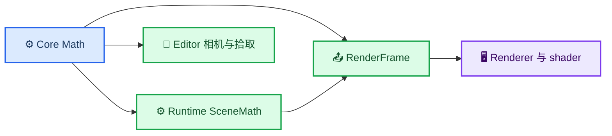

# ADR-001：统一 Core Math 层

_记录 MEngine 数学约定、API 边界、迁移结果与后续演进约束；2026-09-12。_

| 字段 | 值 |
| --- | --- |
| 状态 | Implemented |
| 范围 | Core、Runtime、Editor、RenderCore、Renderer |
| 取代 | 未编译的旧 `Core/Math` 学习代码 |

---

## 📋 背景

迁移前，`Engine/Engine/Core/Math` 没有加入 `MEngineCore`，实际计算分散在 `SceneMath.cpp`、`EditorCamera.cpp`、`EditorScenePicker.cpp`、`RHIRenderer.cpp` 和 D3D12 示例中。旧目录又包含错误 include、未定义宏、修改自身的 `const` 运算符、缺失矩阵类型和无返回值函数，因此不能直接启用。

问题不只是重复代码。矩阵布局、向量乘法方向、旋转顺序、裁剪深度与 shader 上传中的任一约定发生漂移，都会让渲染、相机和拾取以不同方式解释同一 Transform。

## 🎯 固定约定

以下规则是代码契约，不是可由调用方自由选择的配置：

| 维度 | 约定 | 可执行证据 |
| --- | --- | --- |
| 坐标与相机 | 左手观察语义，`+X` 右、`+Y` 上、`+Z` 前 | `MEngineMathConventionTests` |
| 存储 | 行主序，索引为 `row * 4 + column` | 平移位于索引 `12..14` |
| 向量 | 行向量右乘矩阵 | `Transform(value, matrix)` |
| 组合 | `local * view * projection` | Core 与 Renderer 测试/实现 |
| Euler | XYZ 顺序，场景字段使用度 | `EulerXYZMatrix()` |
| Core 角度 | `Degrees`、`Radians` 显式转换 | `ToRadians()`、`ToDegrees()` |
| 投影 | 左手透视，NDC 深度 `[0,1]` | 近平面映射 0，远平面映射 1 |
| shader | `row_major float4x4` 与 `mul(position, matrix)` | CPU 上传前不转置 |

这些约定也以 `conventions.h` 中的 `constexpr` 值表达。它们让代码审查能直接定位错误假设，但真正防回归的是数值测试。

## 🔍 决策

采用最小、自有、header-only 的 `GE::Math` 基础层：

- `Vec2`、`Vec3`、`Vec4` 提供连续值存储、索引、Dot、Cross、长度和归一化
- `Mat4` 提供行主序访问、矩阵乘法、点/向量变换、S/R/T、转置与 D3D 透视投影
- `Quaternion` 提供单位化、轴角构造和与 `Mat4` 一致的旋转矩阵
- `Ray3`、`Aabb3` 与 Ray/AABB 相交提供必要几何原语
- `Degrees` 与 `Radians` 禁止通过全局可变状态决定角度单位

`RenderCore::RenderMatrix4` 现在是 `Math::Mat4` 的语义别名，因此帧快照不再维护第二种矩阵表示。`Mat4` 保持 16 个连续 `float`、可平凡复制；Renderer 对常量缓冲大小使用 `static_assert`，可直接上传到声明为 `row_major` 的 HLSL 矩阵。

### 保留领域语义

统一基础运算不等于把所有函数塞进 Math：

- `MakeSceneLocalToWorldMatrix()` 仍由 Runtime 定义 Transform 的 S/R/T 业务语义
- `MakeSceneViewMatrix()` 与 `MakeSceneProjectionMatrix()` 仍负责 CameraComponent 到矩阵的转换
- EditorCamera 仍负责输入、速度、俯仰限制和 viewport ray 语义
- EditorScenePicker 仍负责可见性、MeshHandle、对象 Transform 和相机裁剪范围
- Renderer 仍负责 `world * view * projection` 的提交时组装

Core Math 只拥有可跨域复用且不依赖上层对象模型的计算。

## ⚡ 影响

### 正面影响

- Runtime、Editor、Renderer 和示例共享同一矩阵实现
- 数学层不依赖 Runtime、RHI、Renderer、Editor 或平台 API
- CPU/HLSL 转置约定由类型布局、shader 声明和测试共同固定
- 旧残缺实现被替换，不再存在“正式代码绕过 Core Math”的双轨 API
- 未来可在保持 API 和契约测试不变时替换内部实现

### 代价与限制

- `TransformComponent` 的三个向量字段从 `std::array<float, 3>` 迁移为 `Vec3`，仍保留索引与 `data()` 兼容接口
- 当前使用标量实现，尚未进行 SIMD 优化
- 当前只提供已被实际调用或契约测试需要的运算，不承诺大型数学库的完整功能
- 退化矩阵的通用求逆尚未纳入；拾取继续使用经过验证的正交基与缩放逆变换

## ✅ 迁移与验证

| 工作项 | 结果 |
| --- | --- |
| 约定测试 | 完成 |
| Core Vec/Mat4/Quaternion/角度/几何 | 完成 |
| Runtime SceneMath | 完成 |
| EditorCamera 与 EditorScenePicker | 完成 |
| RenderCore 与 RHIRenderer | 完成 |
| D3D12 旋转立方体示例 | 完成 |
| 旧 `math.cpp`、`random.h` 遗留 | 删除 |
| 当前 Debug 与 Release 全量回归 | 均为 `45/45` 通过 |

Math 与 Smoke 测试、正式架构文档均进入版本控制范围；`out/`、构建产物和本地笔记仍保持忽略。

## 🔗 相关文档

- [当前架构](../../ARCHITECTURE.md)
- [Core Math 聚合头](../../Source/Core/Math/math.h)
- [约定定义](../../Source/Core/Math/conventions.h)
- [约定测试](../../Tests/Math/MathConventionTests.cpp)

---

_最后更新：2026-09-12_
