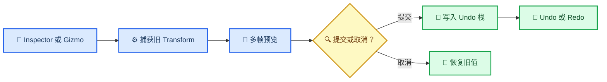

# ADR-002：Transform 编辑使用显式事务

_记录 Inspector 与 Viewport Gizmo 如何共享安全点命令、预览状态和 Undo/Redo；2026-09-12。_

| 字段 | 值 |
| --- | --- |
| 状态 | Implemented |
| 范围 | EditorEngine、Editor UI、Transform Gizmo |
| 当前限制 | 事务仅覆盖 Transform |

---

## 📋 背景

编辑器 UI 在渲染帧中运行，而 World 变更集中在下一次 `EditorEngine::Tick()` 的安全点应用。Inspector 的连续拖动和 Viewport Gizmo 都会跨越多个 UI 帧；若每个预览值都直接形成历史记录，一次拖动会产生大量无意义的 Undo 步骤。

## 🎯 决策

Transform 编辑使用四阶段纯值命令：`BeginTransformEdit` 捕获旧值，`PreviewTransformEdit` 更新 World 和事务末值，`CommitTransformEdit` 只压入一条历史记录，`CancelTransformEdit` 恢复旧值。Inspector 与 Gizmo 共享同一套协议。

事务使用稳定的 `GameObjectId`，不保存 `GameObject*`。Undo/Redo 应用时重新从 EditorWorld 查找对象，因此历史项不会把 World 对象生命周期泄漏到 UI。

## ⚙️ Gizmo 边界

首版 Gizmo 只提供世界空间 X/Y/Z 平移轴：

- Core Math 负责世界点到裁剪空间的通用矩阵运算
- `EditorGizmo` 负责世界轴投影、屏幕拖动到世界位移的换算
- `EditorUserInterface` 负责绘制、命中和鼠标状态
- `EditorEngine` 负责安全点变更、事务历史和场景脏标记

轴接近观察方向、屏幕投影长度过小时，该轴不显示也不参与命中。这比使用不稳定的极大换算系数更安全。

## ⚠️ 当前限制

创建、删除、重命名以及组件增删尚未实现可逆快照。发生这些修改时会清空 Transform Undo/Redo 栈并标记场景已修改，避免用户撤销到与结构历史不一致的状态。后续应将事务负载扩展为显式变体，而不是让 `EditorTransaction` 持有任意回调或裸指针。

当前脏标记是保存后清零、任意后续编辑或 Undo/Redo 后置位的保守模型，尚未通过历史修订号识别“撤销回已保存状态”。

## 🧪 验证

- 多次 Preview 只生成一个 Undo 步骤
- Undo 与 Redo 恢复事务两端的 Transform
- Cancel 恢复 Begin 时捕获的值
- Save 清除脏标记，New/Load 清空历史
- PIE 保持编辑锁定
- Gizmo 投影和屏幕位移换算具有独立 Smoke 测试

## 🔗 相关文档

- [当前架构](../../ARCHITECTURE.md)
- [统一 Core Math 层](001-unify-math-layer.md)
- [项目入口](../../README.md)

---

_最后更新：2026-09-12_
